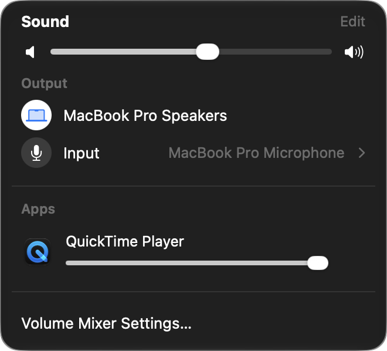
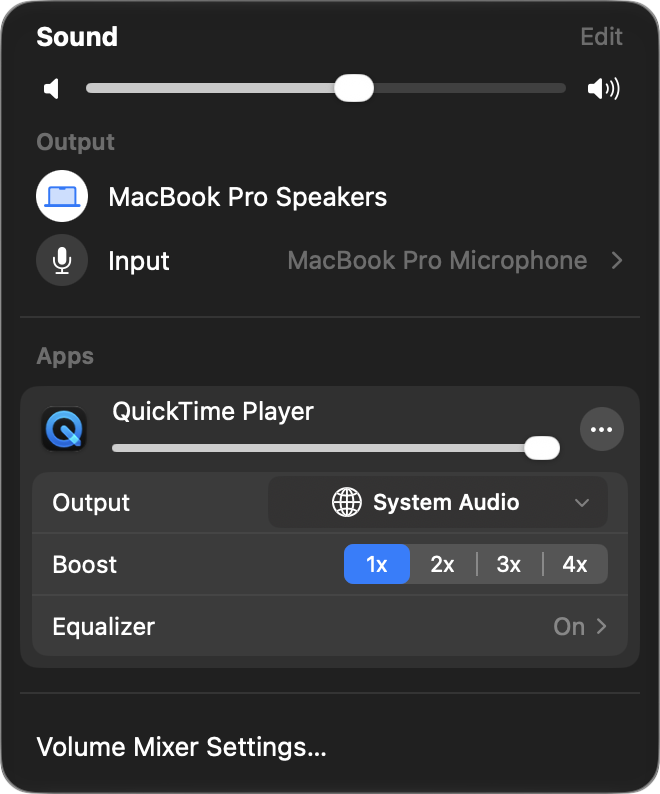

<h3>Volume Mixer</h3>

A per-app volume mixer for the macOS menu bar, laid out like Apple's own Sound menu. Set each app's volume, send it to a different output, boost quiet apps up to 4×, and shape it with an equalizer.

<br clear="all"/>

<p align="center">
  
  &nbsp;
  
</p>

## Features

- **Per-app volume** — every app playing audio gets its own slider; click its icon to mute it
- **Per-app output** — send an app to a different speaker or headphones, or to several at once
- **Boost** — 1× to 4× for apps that are too quiet
- **Equalizer** — 10-band EQ per app, with presets
- **Headphone correction** — [AutoEQ](guide/autoeq.md) profiles per output device
- **Device priority** — choose which output and input to switch to when devices connect
- **Media keys and hotkeys** — control the app that's playing from the keyboard
- **[URL schemes](guide/url-schemes.md)** — script it from Terminal or Shortcuts with `volumemixer://`

The ⋯ button on an app row holds its output, boost and equalizer. **Edit** next to Sound reorders and hides devices and apps.

## Requirements

- macOS 15 or later
- Screen & System Audio Recording permission (asked on first launch)

## Build from source

```bash
git clone https://github.com/coinwaredev/volume-mixer.git
cd volume-mixer
open FineTune.xcodeproj
```

Build the `FineTune` scheme. `scripts/install-local.sh` builds a Release copy, signs it and installs it to `/Applications/Volume Mixer.app`.

Something not working? See [Troubleshooting](guide/troubleshooting.md).

## Credits

Volume Mixer is a modified version of [FineTune](https://github.com/ronitsingh10/FineTune) by Ronit Singh, forked from FineTune 1.9.0 in October 2026. Changes since then include the Sound-menu style dropdown, a new name and icon, trimmed settings, and the removal of the updater. The project and Xcode targets still carry the FineTune name internally.

## License

[GNU GPL v3](LICENSE), the same license as FineTune. Copyright © 2026 Ronit Singh, with modifications by coinwaredev.
